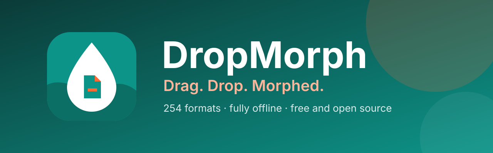

<p align="center">
  
</p>

<p align="center">
  <b>A free file converter you use by dragging.</b><br>
  Hold <kbd>Ctrl</kbd> (<kbd>Option</kbd> on macOS), drag files and drop them on a format in the donut that opens at your cursor.
</p>

<p align="center">
  <a href="https://dropmorph.vercel.app/"><b>Website</b></a> ·
  <a href="https://github.com/cod4nitish/DropMorph/releases/latest"><b>Download</b></a> ·
  <a href="#install">Install</a> ·
  <a href="#command-line">Command line</a> ·
  <a href="#development">Development</a>
</p>

<p align="center">
  <a href="https://github.com/cod4nitish/DropMorph/actions/workflows/ci.yml"></a>
  <a href="https://github.com/cod4nitish/DropMorph/releases/latest"></a>
  
  
  <a href="LICENSE"></a>
</p>

<table>
  <tr>
    <td width="33%" valign="top"><b>Right at your cursor</b><br>No app window to open. The formats appear where you already are, and only the ones that make sense for the files you drag.</td>
    <td width="33%" valign="top"><b>254 formats, no other software</b><br>Images, PDF, Word, Excel, PowerPoint, HWP, e-books, archives, fonts, CAD, 3D models and map data, without Office or LibreOffice.</td>
    <td width="33%" valign="top"><b>Stays on your computer</b><br>Nothing is uploaded. DropMorph works offline and saves the result next to the original.</td>
  </tr>
</table>

## Install

Download from [Releases](https://github.com/cod4nitish/DropMorph/releases/latest).

- **Windows 10/11**: run `DropMorph-<version>-win-Setup.exe`, or unzip the `win-Portable.zip` and run `DropMorph.exe`.
  Setup can add the Explorer menu, start at sign-in, the `dropmorph` command and optional engines.
- **macOS 14+** (preview): unpack the `osx-arm64` or `osx-x64` package and run `./install.sh`.
  The build isn't notarized, so allow the first start in System Settings → Privacy & Security → **Open Anyway**.
- **Linux x64/ARM64** (preview, Ubuntu 22.04+): unpack the package and run `./install.sh` (no root, needs Python 3).
  Drag gestures need X11. On Wayland, use the drop zone and the file manager's right-click menu.

Releases are not code-signed, so Windows SmartScreen may warn when you run the installer ("More info" → "Run anyway").
DropMorph shows new releases in its menu and updates itself, keeping your settings and engines.

## Features

- **A donut at the cursor**: hold a key, drag files and drop them on a format. Only formats that fit the files appear.
- **One toolbar per file type**, arranged by drag and drop, with presets for quality, size, DPI, PDF pages and compression,
  video and audio, output folder and file names.
- **Many files at once**, in parallel. Routes with several steps (HWP → HWPX → DOCX) are found automatically.
- **Watch folders** convert every file that lands in them.
- **Other ways in**: the right-click menu, a keyboard shortcut, the drop zone and the [`dropmorph` command](#command-line).
- Light and dark themes with your own accent colour, in English, हिन्दी, Español, 한국어, 简体中文 and Polski.

## Formats

| From | To |
|---|---|
| **Images**: JPG, PNG, WEBP, AVIF, TIFF, BMP, GIF, APNG, ICO, ICNS, JPEG XL, JPEG 2000, PSD/PSB, TGA, PPM, HEIC, QOI, DDS, PCX, MNG, CUR, …; GIMP XCF, camera RAW (CR2, CR3, NEF, ARW, DNG, …), DICOM, OpenEXR, HDR, JPEG XR (Windows) read | any of these (HEIC⁵), PDF, SVG (traced), resized, grayscale |
| **Vector**: SVG, SVGZ, EMF, WMF, AI · EPS, PS¹ · CDR, VSD, CGM, ODG, FODG² | PDF (vector), PNG and other images, SVG ↔ SVGZ, SVG → DXF/DWG, PDF → EPS/PS¹, SVG → EMF, WMF, ODG² |
| **PDF** | DOCX, HWPX, TXT, PNG, JPG, TIFF, CBZ, PPTX (a picture of each page), SVG²; merge, split, page ranges, compress (smaller PDFs) |
| **Documents**: DOCX, DOCM, DOTX, EML, Outlook MSG; OFD (Chinese e-invoices, official documents) read · DOC, ODT, FODT, OTT, RTF, WPS, WPD, Pages, ClarisWorks, MacWrite, T602, …² | PDF, DOCX, HWPX, EPUB, TXT, HTML; MSG → EML · ODT, FODT, OTT² |
| **Spreadsheets**: XLSX, XLSM, XLS, XLT, ODS, CSV, TSV · OTS, FODS, Numbers, ET² | PDF, XLSX, ODS, CSV, TSV, JSON, HWPX, HTML · XLT, OTS² |
| **Presentations**: PPTX, PPTM, POTX, POTM, PPSX · PPT, ODP, OTP, FODP, Keynote² | PDF, PNG, JPG, DOCX, HWPX · OTP² |
| **HWP**: HWP, HWPX | PDF, PNG, DOCX, HWPX ↔ HWP, TXT, Markdown, HTML |
| **Text**: TXT, Markdown, HTML; MHTML (saved web pages) read · reStructuredText, LaTeX, Org, AsciiDoc, Typst, MediaWiki, DocBook, Jupyter, Textile, man, OPML³ | PDF, DOCX, HWPX, EPUB · each other, PPTX slides³ |
| **E-books**: EPUB, KEPUB, MOBI, AZW3, AZW, AZW4, FB2, CBZ, CBR, CB7, HTMLZ, TXTZ · LIT, LRF, CHM, PDB, …⁴ | PDF, EPUB, KEPUB (Kobo), DOCX, TXT, HTML, HWPX · MOBI, AZW3⁴ |
| **Video**⁵: MP4, MOV, MKV, WEBM, AVI, WMV, FLV, MPEG, TS, M2TS, 3GP, OGV, VOB, … | MP4 (H.264, HEVC, AV1), WEBM, MOV, MKV, AVI, GIF, APNG, MP3, M4A, 720p, subtitles (SRT, ASS, WebVTT) |
| **Audio**⁵: MP3, M4A, AAC, WAV, FLAC, OGG, OPUS, WMA, AIFF, AMR, APE, WavPack, TTA, DSD (DSF, DFF), DTS, AC3, E-AC3, … | MP3, M4A (AAC, ALAC), WAV, FLAC, OGG, OPUS, AAC, WavPack, TTA, W64, AC3, E-AC3 |
| **Subtitles**: SRT, ASS/SSA, WebVTT, SAMI (SMI), LRC, TTML, MicroDVD, SCC | each other as UTF-8 (Korean CP949 files read correctly) |
| **Archives**: ZIP, 7Z, RAR, TAR, TAR.GZ, TAR.BZ2, TAR.XZ, GZ, ISO, CAB, DMG, ALZ, EGG, … | extract, ZIP, 7Z, TAR, TAR.GZ; any files → one ZIP |
| **CAD**: DWG, DXF | PDF, SVG, PNG, DWG ↔ DXF |
| **Fonts**: TTF, OTF, WOFF, WOFF2, EOT | each other |
| **Data**: JSON, JSON Lines, YAML, TOML, XML · vCard | each other, CSV and XLSX (tables); vCard ↔ CSV |
| **3D models**: GLB, glTF, STL, OBJ (+ MTL), 3MF, PLY; FBX read | each other, PNG preview |
| **Geospatial vectors**: Shapefile, GeoJSON, KML, KMZ, GPX · CSV with coordinates | each other and CSV / XLSX / JSON; projected data (UTM, Web Mercator, Lambert, Albers) comes out as WGS 84 longitude / latitude |

Unmarked formats work out of the box, without Office, Hancom Office or LibreOffice.
Marked ones need an optional engine, downloaded only when needed: ¹ Ghostscript, ² LibreOffice, ³ Pandoc, ⁴ calibre,
⁵ FFmpeg ([details](docs/ENGINES.md)).

## Command line

The `dropmorph` command uses the same engines and presets as the app (Setup or `install.sh` adds it).

```
dropmorph convert photo.heic --to jpg
dropmorph convert *.png --to webp --quality 80 -o converted
dropmorph watch D:\Inbox --to pdf --move-originals
```

Every command and option: `dropmorph help`.

## Development

Build with the .NET 10 SDK on Windows, macOS or Linux:

```bash
git clone https://github.com/cod4nitish/DropMorph.git
cd DropMorph
pwsh build/fetch-engines.ps1 -Only rhwp,pandoc   # optional engines
dotnet run --project src/DropMorph.App
dotnet test
```

[Architecture](docs/ARCHITECTURE.md) · [Engines](docs/ENGINES.md) · [Adding a converter](docs/ADDING-A-CONVERTER.md) ·
[Adding a language](docs/ADDING-A-LANGUAGE.md) · [Contributing](CONTRIBUTING.md)

## Privacy

DropMorph converts files on your own computer and never uploads them. It collects no usage data and sends no telemetry.
It connects to the internet only:

- to ask GitHub (`api.github.com`) whether a newer release exists, shortly after start and then every few hours.
  Turn this off in Settings → About ("Check for updates automatically").
- to download the conversion engines you choose to install, from the official locations pinned in
  [`engines.json`](src/DropMorph.Engines/Infrastructure/engines.json).
- when you click a link, which opens your web browser.

<!-- sponsors: src/DropMorph.App/Assets/Sponsors/sponsors.json -->

## License

MIT, see [LICENSE](LICENSE). Bundled third-party components keep their own licenses, listed in
[THIRD-PARTY-NOTICES.md](THIRD-PARTY-NOTICES.md).

Made by [Nitish Singh](https://github.com/cod4nitish).
